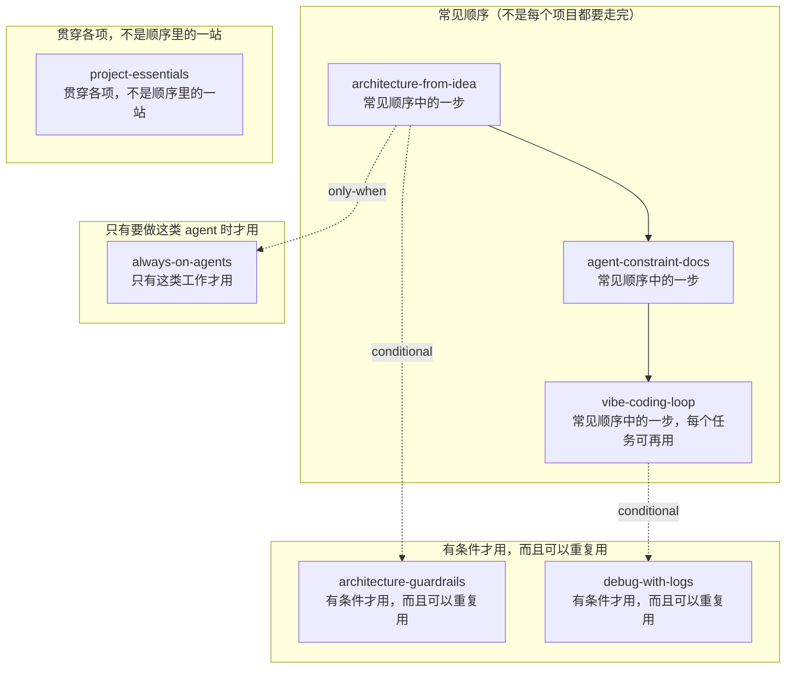

# Skills navigation / Skills 总导航

This page is the catalog of skills in this repository: what each one is for, and how they relate. It is not a project's progress, and it is not a system architecture.
这一页是本仓库的 Skill 目录：每个 Skill 做什么、它们怎么关联。它不是某个项目的进度，也不是系统架构。

Usage status is not stored here. Each consuming project keeps its own `SKILL_MAP.md` and `.skill-map/usage.json` in that project's root. Two projects can share this source and still have different histories.
使用状态不写在这里。每个使用方项目在自己的根目录保存 `SKILL_MAP.md` 和 `.skill-map/usage.json`。两个项目可以共用这份技能目录，历史仍然各记各的。

The check does not run by itself, and there is no background process. At the start of work, the agent runs this command because the project's `AGENTS.md` tells it to. `--project` must be that project's absolute root. A relative project path is rejected so the current working directory cannot redirect the write.
这条命令不会自己跑，也没有后台服务。开工时由 agent 按项目 `AGENTS.md` 里的说明来运行。`--project` 必须是那个项目根目录的绝对路径。相对的项目路径会被拒绝，避免当前工作目录把写入指到别处。

```bash
/absolute/path/to/agent-skills/navigation/skill-map sync \
  --project /absolute/path/to/your-project \
  --source /absolute/path/to/agent-skills/skills
```

`--source` may be absolute, or relative to the project root (not to the current working directory). The command reads the source and writes only `<project>/SKILL_MAP.md` and `<project>/.skill-map/usage.json`.
`--source` 可以是绝对路径，或者相对项目根（不是相对当前工作目录）。命令只读技能目录，只写 `<项目>/SKILL_MAP.md` 和 `<项目>/.skill-map/usage.json`。

On failure it prints the reason to stderr, exits non-zero, and leaves the previous map in place. A missing source, an unreadable file, or a malformed map, catalog, or skill file does not partially update the project. New skills are added as `unverified`. A skill removed from the source stays in the map as unavailable, with its notes, evidence, and history. Relationships that are not in `navigation/catalog.json` stay unknown. Setup, exit codes, and conflicts: [navigation/README.md](navigation/README.md).
失败时把原因写到 stderr，以非 0 退出，并留下原来的地图。技能目录不存在、文件读不了，或地图、目录、技能文件格式坏了，都不会把项目改到一半。新 Skill 以 `unverified`（未核实）加入。从目录里删掉的 Skill 仍留在地图里，标成源已不在，备注、证据和历史都还在。`navigation/catalog.json` 里没有的关系保持未知。安装、退出码和冲突的说明见 [navigation/README.md](navigation/README.md)。

Current-location highlighting (正在用 / 下一步) lives in the project's `SKILL_MAP.md`, not on this page. The picture below has no "you are here" mark.
「正在用 / 下一步」的高亮在项目自己的 `SKILL_MAP.md` 里，不在这一页。下面这张图没有「你在这里」的标记。

Regenerate this page after adding a skill or a relation:
加了 Skill 或关系之后，重新生成这一页：

```bash
navigation/skill-map render-library \
  --source /absolute/path/to/agent-skills/skills \
  --out /absolute/path/to/agent-skills/NAVIGATION.md
```

Do not hand-edit the generated lists below. Change `navigation/catalog.json` or the skill folder, then run the command again.
不要手改下面生成的列表。改 `navigation/catalog.json` 或 Skill 文件夹，然后重新运行上面的命令。

## Map / 地图



Text fallback / 文本回退：看不清图时读下面的句子和表。实线只连接常见顺序里相邻、且目录里写了 typical-next 的 Skill。没有把七个 Skill 排成必经站。有条件的、可重复的、以及只有特定 agent 才用的，分开画。关系未知的 Skill 单独成组，不给它编造箭头。

Typical chain / 常见顺序（不是每个项目都要走完）：`architecture-from-idea` → `agent-constraint-docs` → `vibe-coding-loop`。project-essentials stays cross-cutting. architecture-guardrails and debug-with-logs are conditional and can be used again. always-on-agents applies only when the project is that kind of agent.

Relationship unknown / 关系未知：（无 / none）。

## Skills / 技能

| Skill | Role | When the description says to use it | File |
| --- | --- | --- | --- |
| `architecture-from-idea` | 常见顺序中的一步 (chain) | Use when architecture is not decided yet and the user has a software idea or a new project, or wants to start the full flow from idea through architecture to coding: first choose throwaway demo vs tracer-bullet skeleton vs long-lived product, then pick the architecture (layers,… | `architecture-from-idea/SKILL.md` |
| `agent-constraint-docs` | 常见顺序中的一步 (chain) | Use when architecture is already agreed and the next step is to write or update documents that coding agents follow (AGENTS.md / CLAUDE.md, PRD, ARCHITECTURE, RULES or standards, exec plans, ADRs, acceptance records, PR and task templates); when creating them from an agreed… | `agent-constraint-docs/SKILL.md` |
| `vibe-coding-loop` | 常见顺序中的一步，每个任务可再用 (chain-repeatable) | Use for each coding task an AI agent will implement in a repo that already has (or is getting) agent docs: turn the request into a scoped task (goal, context, constraints, done-when), plan first if non-trivial, implement inside the architecture, verify with real commands, review… | `vibe-coding-loop/SKILL.md` |
| `project-essentials` | 贯穿各项，不是顺序里的一站 (cross-cutting) | Use when a beginner or vibe coder starts a new project, picks up an existing one, or prepares to share or release it, and needs the basics every real project must have: version control and rollback, secrets and config, one-command run and README, tests, error handling, data… | `project-essentials/SKILL.md` |
| `architecture-guardrails` | 有条件才用，而且可以重复用 (conditional-repeatable) | Use when an architecture rule must hold without exceptions (dependency direction, UI must not import core internals, file size caps, no secrets, generated files untouched) and should be enforced by a linter, structural test, CI gate, or agent hook instead of prose. Also when… | `architecture-guardrails/SKILL.md` |
| `debug-with-logs` | 有条件才用，而且可以重复用 (conditional-repeatable) | Use when something is broken and the cause is not known yet: an error message, a crash, a blank or white screen, a failing test, wrong output, or "it worked yesterday". Walks a beginner through reproduce, find the logs, read them by request_id, state a root-cause hypothesis,… | `debug-with-logs/SKILL.md` |
| `always-on-agents` | 只有这类工作才用 (only-when) | Use when designing or building an always-on agent: an agent that wakes up on events (webhooks, user messages, background jobs) or on timers (follow-ups, daily or weekly schedules), works unattended across many runs, and reaches the user without being asked. Walks through… | `always-on-agents/SKILL.md` |

## Relations / 关系

A relation is a hint from the skill text cited in Source. It is not a usage record, and it does not mean every project takes that step.
关系是技能正文里的提示，出处写在 Source。它不是使用记录，也不表示每个项目都要走这一步。

| From | To | Kind | When | Source |
| --- | --- | --- | --- | --- |
| architecture-from-idea | agent-constraint-docs | typical-next | 架构定稿之后，下一步是写给 AI 的约束文档。 | skills/architecture-from-idea/SKILL.md |
| agent-constraint-docs | vibe-coding-loop | typical-next | 文档已经有了，每个编码任务用一次。 | skills/agent-constraint-docs/SKILL.md |
| architecture-from-idea | vibe-coding-loop | typical-next | 约束文档写完之后，每个任务进入编码循环。 | skills/architecture-from-idea/SKILL.md |
| architecture-from-idea | architecture-guardrails | conditional | 有不能有例外的规则，要变成机器检查时。 | skills/architecture-from-idea/SKILL.md |
| agent-constraint-docs | architecture-guardrails | conditional | 规则已经写进文档，下一步要机器强制时。 | skills/agent-constraint-docs/SKILL.md |
| vibe-coding-loop | architecture-guardrails | conditional | 硬规则要机器强制，或同一错误写进文档仍然管不住时。 | skills/vibe-coding-loop/SKILL.md |
| vibe-coding-loop | debug-with-logs | conditional | 出了 bug 但原因还不知道时，先定位，再回来提交。 | skills/vibe-coding-loop/SKILL.md |
| debug-with-logs | vibe-coding-loop | typical-next | 修好之后的提交和审查回到编码循环。 | skills/debug-with-logs/SKILL.md |
| debug-with-logs | architecture-guardrails | conditional | 日志规则要变成机器检查时。 | skills/debug-with-logs/SKILL.md |
| architecture-from-idea | always-on-agents | only-when | 要做被事件或定时器叫醒、用户不在时也干活的 agent。 | skills/architecture-from-idea/SKILL.md |
| always-on-agents | architecture-from-idea | only-when | 还没定档位和整体架构时先分流。本技能是那一步里的一个专题，不是必经站。 | skills/always-on-agents/SKILL.md |
| always-on-agents | agent-constraint-docs | typical-next | 五个部件设计定了，写成给 AI 的文档。 | skills/always-on-agents/SKILL.md |
| always-on-agents | vibe-coding-loop | typical-next | 实现时一个部件一个编码任务。 | skills/always-on-agents/SKILL.md |
| always-on-agents | architecture-guardrails | conditional | 同一事件只跑一次、密钥不进 agent 环境这类硬规则要机器强制时。 | skills/always-on-agents/SKILL.md |
| always-on-agents | debug-with-logs | conditional | 跑起来出了问题，按 run_id 和 event_id 查日志。 | skills/always-on-agents/SKILL.md |

## What this scan saw / 这次扫到的目录

- Skill count / Skill 数量：7
- Source label / 来源：`skills` (the directory passed to render-library; this file does not store a machine-specific path)

Skills present in this scan:

- `agent-constraint-docs`
- `always-on-agents`
- `architecture-from-idea`
- `architecture-guardrails`
- `debug-with-logs`
- `project-essentials`
- `vibe-coding-loop`
