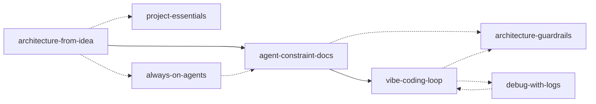

# Skills 总导航

这一页说明本仓库里有哪些 Skill、它们通常怎么配合。它不是某个项目的进度，也不是系统架构。

使用这些 Skill **不需要** Python、Node 或任何别的运行时，也没有扫描脚本、后台进程或钩子。把 Skill 装进工具，或让 agent 读了 `SKILL.md`，都不会自动执行里面的步骤。

使用状态不写在这一页。每个项目在**自己的根目录**放两份文件：[`SKILL_MAP.md`](skills/agent-constraint-docs/templates/SKILL_MAP.md) 是记录，[`SKILL_MAP.html`](skills/agent-constraint-docs/templates/SKILL_MAP.html) 是给人看的静态路线图。两个项目可以共用这份技能库，各自的两份文件分开。不需要 Python、Node 或浏览器以外的任何程序。双击 HTML 用本机浏览器打开即可。打开它不会监视文件夹。

## 开工时 agent 做什么

用平时读文件的方式看 `skills/` 下面每个带 `SKILL.md` 的目录名，再读本项目的 `SKILL_MAP.md`。

- 目录里有、地图里没有的名字：补一行，状态写 **未核实**。不要给它编造箭头，也不要编造「用过」。
- 地图里有、目录里已经没有的名字：留下，注明 **源已不在**。不删历史。
- 关系没有写在下面表格里的：就当未知，不要补一条看起来合理的关系。
- 项目根不清楚，或可能写到别的项目、写进技能库：停下来问，不要写。
- 改地图之前先把当前文件再读一遍。和上次看到的不一样，就以刚读到的为准，只补上这一段。对不上就停下问，不要另做锁文件。

读过 Skill、装上 Skill，都不是「用过」。真正打开并按那个 Skill 做了，才把状态改成用过或正在用，并写上证据。只看懂报错、给出修复建议，不算用过。

## 下一段工作开始时

地图建好之后，每段工作开始前做一次。不是每条消息都做，也不要把七个 Skill 走一遍。

1. 先看用户这一段要做什么，再读下面「每个 Skill」表的「什么时候用」。对得上的，打开那个 `SKILL.md` 并按它做。对不上就直接做。
2. 程序一跑就失败、报错、白屏或结果不对，而且原因还不知道：任何阶段都先打开 `debug-with-logs`。关系表里它写在 `vibe-coding-loop` 旁边，只说明修好之后回到编码循环，不是说别的阶段不能用。依据是这个 Skill 自己的正文：出了问题、原因还不知道时就用。
3. 没打开那个 Skill，就不要在地图里写成用过或正在用。一段做完，再按下面的步骤改两份文件。

## 新项目第一次

在你要做的那个项目里，对 agent 说一次下面这段话就够了。把尖括号里的路径换成你的技能库目录。之后靠该项目 `AGENTS.md` 里的指针接着记，不用每条消息都再提醒。

```text
当前文件夹就是这个新项目的根目录。技能库在 <agent-skills 的目录>。
请阅读技能库的 NAVIGATION.md，再用你平时读文件的办法看技能库 skills 目录下有哪些 SKILL.md。
然后只在这个项目根目录，按技能库的模板新建 SKILL_MAP.md 和旁边的 SKILL_MAP.html。
看不清该写哪个项目，就停下来问我，不要写到别的目录，也不要写进技能库。
关系不清楚，或者你只是读过文件，都标成未核实，不要编造我已经用过什么。
两份文件写上同一个记录标记。网页写失败就留着旧页，并告诉我它过期。没有新信息不要反复再试，也不要把被拒绝的写入说成已经写好。
写完用几句话告诉我：用过、正在用、下一步、有没有卡住。
以后每段工作开始前，先读 NAVIGATION.md 里「每个 Skill」的「什么时候用」。对得上的就打开那个 SKILL.md 并按它做；对不上就直接做，不要把七个都走一遍。程序一跑就失败、原因还不知道，任何阶段都先打开 debug-with-logs。只看懂报错不算用过它。
一段结束时更新这两份文件，并说完：用过、正在用、下一步、卡住。没打开的 Skill 不要写成用过。不用每条消息都改。
改 HTML 时只写文件，不要为了核对地图去开浏览器。打开网页不会自己更新。
```

## 一段工作结束时

这是唯一的维护步骤。其他文件只指向这里。

1. 确认项目根。看不清，或可能写到别的项目、写进技能库：停下问，两份都不写。
2. 先重读这个项目的 `SKILL_MAP.md`。和上次看到的不一样，就以刚读到的为准。对不上就停下问。
3. 只根据这一段真做了的事改表格和历史。新看到的目录名追加为未核实。不要因为目录存在或文件被读过，就写成用过，或给它画一条线。
4. 写上记录标记。不知道整份地图的更新时间就写 `unknown`，不要编时间。源更新时间没有依据就写「未知」。
5. 用同一个记录标记改旁边的 `SKILL_MAP.html`。路线只保留这一页已经写过的关系。别的名字放在「路线以外」，不画线。本页生成时间单独写，不要拿它充当源更新时间。路线节点和「站点说明」里的状态词要一致。改这个文件时只写文件，不要为了核对地图去打开浏览器、截图或重画页面。人自己双击看。某个 Skill 正文要求的复现、测试或检查，该做还是要做。
6. 网页没写成功：留着旧的 `SKILL_MAP.html`，告诉用户这一页过期或不完整。不要说两份已经同步。没有新信息（例如人明确说现在可以写，或要写的路径已经改对）就不要再试。被拒绝的那次写入不是写成功。
7. 用几句话告诉用户：用过、正在用、下一步、卡住。没有正在用就直接说没有。四句都要说完。没说完就说明收尾不完整，不要当成已经汇报过。
8. 地图只在一段工作结束时改。不是每条消息都改。选哪个 Skill 在段首，按上面「下一段工作开始时」。没有后台任务。装上 Skill 或打开 HTML 都不会自动改文件。两份标记对不上、又分不清哪份新，就停下问。

## 地图

实线是常见顺序，不是七个都要走。虚线是有条件才用，而且可以再用。



看不清图时读这几句：

- 还没定架构：`architecture-from-idea`。架构定了：`agent-constraint-docs`。文档有了，每个编码任务用一次 `vibe-coding-loop`，不要一个对话做完整个应用。
- `project-essentials` 是贯穿的强制项，不是顺序里的一站。开工或发布时按档位看。
- 有不能例外的规则，才用 `architecture-guardrails`，而且可以再用。
- 任何阶段出了 bug，用 `debug-with-logs` 先定位，修好再回到 `vibe-coding-loop`。
- 只有要做被事件或定时器叫醒的 agent，才用 `always-on-agents`。

## 每个 Skill

| Skill | 角色 | 什么时候用 | 文件 |
| --- | --- | --- | --- |
| `architecture-from-idea` | 常见顺序 | 有想法或新项目，要先分流、定架构。未确认路径前不写业务代码。 | [SKILL.md](skills/architecture-from-idea/SKILL.md) |
| `agent-constraint-docs` | 常见顺序 | 架构已经或正在定下来，要写 agent 会遵循的文档。 | [SKILL.md](skills/agent-constraint-docs/SKILL.md) |
| `vibe-coding-loop` | 常见顺序，每个任务可再用 | 文档有了之后，一个编码任务走一轮。 | [SKILL.md](skills/vibe-coding-loop/SKILL.md) |
| `project-essentials` | 贯穿，不是一站 | 按档位核对强制项。不是门禁表的替代品，细则只在 MANDATORY.md。 | [SKILL.md](skills/project-essentials/SKILL.md) |
| `architecture-guardrails` | 有条件，可再用 | 硬规则要变成 lint、CI 或 hook。 | [SKILL.md](skills/architecture-guardrails/SKILL.md) |
| `debug-with-logs` | 有条件，可再用 | 出了 bug，先按日志定位。 | [SKILL.md](skills/debug-with-logs/SKILL.md) |
| `always-on-agents` | 只有这类工作才用 | 收件箱、定时器、记忆、权限、发件箱。 | [SKILL.md](skills/always-on-agents/SKILL.md) |

## 关系

关系来自对应 Skill 正文里已经写的下一步，不是使用记录。表里没有的，就是未知。

| 从 | 到 | 哪种 | 什么时候 | 出处 |
| --- | --- | --- | --- | --- |
| `architecture-from-idea` | `agent-constraint-docs` | 常见下一步 | 架构定稿之后，写给 AI 的文档 | [architecture-from-idea](skills/architecture-from-idea/SKILL.md) |
| `agent-constraint-docs` | `vibe-coding-loop` | 常见下一步 | 文档有了，每个编码任务用一次 | [agent-constraint-docs](skills/agent-constraint-docs/SKILL.md) |
| `architecture-from-idea` | `architecture-guardrails` | 有条件 | 不能有例外的规则要变成机器检查 | [architecture-from-idea](skills/architecture-from-idea/SKILL.md) |
| `vibe-coding-loop` | `debug-with-logs` | 有条件 | 出了 bug 但原因还不知道 | [vibe-coding-loop](skills/vibe-coding-loop/SKILL.md) |
| `debug-with-logs` | `vibe-coding-loop` | 常见下一步 | 修好之后的提交和审查回到编码循环 | [debug-with-logs](skills/debug-with-logs/SKILL.md) |
| `architecture-from-idea` | `always-on-agents` | 只有这类工作 | 要做用户不在时也会被叫醒的 agent | [architecture-from-idea](skills/architecture-from-idea/SKILL.md) |
| `always-on-agents` | `agent-constraint-docs` | 常见下一步 | 五个部件定了，写成给 AI 的文档 | [always-on-agents](skills/always-on-agents/SKILL.md) |

`debug-with-logs` 什么时候用，以它自己的正文为准：出了问题、原因还不知道就用，不要求先走到 `vibe-coding-loop`。见 [debug-with-logs](skills/debug-with-logs/SKILL.md)。

## 以后多了一个 Skill

在 `skills/<名字>/` 里放一份 `SKILL.md` 即可。这一页如果还没写它和谁有关，关系就是未知，不要为了整齐补箭头。项目开工时 agent 仍会在该项目的 `SKILL_MAP.md` 里看到这个新名字，并标成未核实；HTML 里放在「路线以外」，不画线。

## 状态词

中文是给人看的，英文名保持一致，方便对原文。

| 中文 | 英文 | 含义 |
| --- | --- | --- |
| 未核实 | unverified | 看到了，还没判断。新 Skill 用这个。 |
| 正在用 | using | 这一段正在用。可以同时有几个。必须有证据。 |
| 用过 | used | 以前真的用过。必须有证据。不是任务完成。 |
| 下一步 | next | 接着要打开的，要写理由。 |
| 有条件才用 | conditional | 只有某些情况才用，要写理由。 |
| 用不上 | inapplicable | 这个项目用不上，要写理由。 |
| 卡住 | blocked | 这一步走不下去，要写原因。不是「用不上」。 |
| 源已不在 | unavailable | 技能库里已经没有这个目录。历史仍留着。 |
