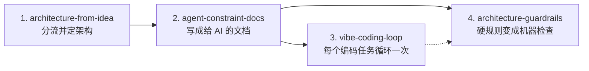
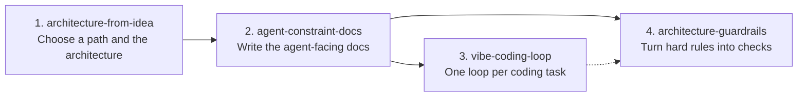

# agent-skills

A collection of programming and AI agent skills (primarily `SKILL.md` files) for [Cursor](https://cursor.com/docs/skills), [Claude Code](https://code.claude.com/docs/en/skills), [Codex](https://learn.chatgpt.com/docs/build-skills), Grok, and other coding agents.

一套给 [Cursor](https://cursor.com/docs/skills)、[Claude Code](https://code.claude.com/docs/en/skills)、[Codex](https://learn.chatgpt.com/docs/build-skills)、Grok 等 coding agent 使用的编程 Skill 合集（以 `SKILL.md` 为主）。

This repository will keep growing. It is not limited to the four skills below.

本仓库会持续加入更多 Skill，不局限于下面这 4 个。

- [中文说明](#中文说明)
- [English guide](#english-guide)

---

## 中文说明

### 当前这 4 个 Skill 是做什么的

它们是一套可插拔的工作流，覆盖「只有一个想法」到「让 AI 按约束写代码」：

| Skill | 什么时候用 | 主要产出 |
| --- | --- | --- |
| [`architecture-from-idea`](skills/architecture-from-idea/) | 架构还没定，或想从想法走到编码的完整流程 | 路径选择（原型 / 曳光弹 / 长期项目）、架构决定、ADR |
| [`agent-constraint-docs`](skills/agent-constraint-docs/) | 架构已经定了，下一步是写（或更新）给 AI 的文档 | `AGENTS.md` / `CLAUDE.md`、PRD、ARCHITECTURE、RULES，以及计划、ADR、PR / 任务模板 |
| [`vibe-coding-loop`](skills/vibe-coding-loop/) | 文档已经有了（或正在补），下一步按任务写代码 | 有边界的任务单、必要时的计划、实现、真实命令证据、审查 |
| [`architecture-guardrails`](skills/architecture-guardrails/) | 某条规则不能有例外，要把文档里的规定变成机器检查 | lint、结构测试、CI 门禁或 agent hook，以及失败时的改法说明 |

配套文件要一起安装，不要只拷 `SKILL.md`：

- `architecture-from-idea`：`DEMO.md`（原型细则）、`LONG.md`（长期项目细则）、`PRINCIPLES.md`（需要向人解释术语时再读）
- `agent-constraint-docs`：`templates/` 下的空白模板
- `architecture-guardrails`：`recipes/` 下的检查配方（含 `recipes/logging.md` 日志检查）
- `vibe-coding-loop`：只有 `SKILL.md`

### 运行日志：从定架构就开始提醒

没有日志的项目，测试时出了错只能猜。所以这 4 个 Skill 会在对应的那一步提醒你把程序运行日志设计进去：

- `architecture-from-idea`：问清「出了问题谁看日志、在哪看」；把日志定成一条架构决定（日志在端口后面、结构化、级别、请求 ID 贯穿各层、在边界记、绝不记密钥和个人数据、日志去哪），写一条 ADR。原型只要一条底线：出错带上下文打印到一个地方。
- `agent-constraint-docs`：ARCHITECTURE 模板有可直接填的日志节（字段表、级别表、事件表）；RULES 模板有日志规则 L-01 到 L-05；`AGENTS.md` 模板有「看日志」命令。
- `vibe-coding-loop`：新代码跨边界时加日志；修 bug 先读日志；日志定位不到时，先补日志再修。
- `architecture-guardrails`：`recipes/logging.md` 列出哪些日志规则能机器检查（core 禁裸 print、禁空 catch、日志不记密钥等），哪些只能 review。

### 它们怎么配合（可插拔）

推荐的完整顺序：



- 还没定架构，或要从想法走完全流程：从 `architecture-from-idea` 开始。
- 架构已经定了，下一步写文档：直接用 `agent-constraint-docs`。
- 文档已经有了，下一步写代码：直接用 `vibe-coding-loop`。每一次编码任务用一次，不要在一个对话里做整个项目。
- 规则已经写在 ARCH / RULES 里，下一步做门禁：直接用 `architecture-guardrails`。循环里同一错误犯了两次、文档仍然管不住时，也可以再打开它。

不必四个都用。已经有架构就不必从想法重来；只做会扔掉的原型时，用 `architecture-from-idea` 的原型路径，不要搭完整文档体系和全套门禁。

自动触发靠的是每份 `SKILL.md` 开头 `description` 与当前对话的匹配，并不是做完上一步就自动跳到下一步。如果 agent 没有自己选中，可以在对话里点名 Skill，或用 `/skill-name`（Cursor、Claude Code 等支持斜杠调用的产品）。

这些 Skill 不会在产品之间自动搬家。例如你在 Cursor 或 Grok 里用完，再换到 ChatGPT 网页或另一个尚未安装它们的环境，需要在那个环境里重新安装。

### 怎么安装

先克隆本仓库，再把**整个 Skill 目录**拷到 agent 会扫描的位置。不要只拷 `SKILL.md`，否则 `DEMO.md`、`templates/`、`recipes/` 等附属文件会丢。

```bash
git clone https://github.com/wisdom-km/agent-skills.git
```

下面只安装当前这 4 个（以后仓库里若有更多 Skill，按同样方式拷贝对应目录即可）：

```bash
cp -R agent-skills/skills/architecture-from-idea \
      agent-skills/skills/agent-constraint-docs \
      agent-skills/skills/vibe-coding-loop \
      agent-skills/skills/architecture-guardrails \
      <你的 skills 目录>/
```

把 `<你的 skills 目录>` 换成下面之一。

#### Cursor

官方会从这些位置自动发现 Skill，见 [Cursor Agent Skills 文档](https://cursor.com/docs/skills)：

| 位置 | 范围 |
| --- | --- |
| 项目里的 `.cursor/skills/` 或 `.agents/skills/` | 只对这个仓库生效；提交进仓库后，团队和 Cloud Agent 都能用 |
| 用户目录 `~/.cursor/skills/` 或 `~/.agents/skills/` | 本机所有项目可用。Windows 下是 `%USERPROFILE%\.cursor\skills\` |

Cursor 为了兼容，也会读取 `.claude/skills/`、`.codex/skills/` 以及对应的用户目录。

在 Agent 对话里输入 `/`，再搜索 Skill 名字，可以手动调用。若希望整个会话都保持某个 Skill，把它当作 Custom Mode 使用（macOS 用 Option+Enter，Windows 用 Alt+Enter）。

说明：Cursor **不会**只凭 GitHub 地址自动导入本仓库。官方的「从 GitHub 仓库导入插件」需要仓库里有 `.cursor-plugin/marketplace.json`。本仓库目前没有这份文件，所以请用上面的拷贝方式。若要把个人目录里的 Skill 提供给自己启动的 Cloud Agent，需要在 Cursor 设置里打开对 Cloud Agent 的 Skill 同步；只有 `~/.cursor/skills/` 会同步，项目内 Skill 则应提交到仓库的 `.cursor/skills/`。

#### Claude Code

见 [Claude Code Skills 文档](https://code.claude.com/docs/en/skills)：

| 位置 | 范围 |
| --- | --- |
| 项目里的 `.claude/skills/<skill-name>/SKILL.md` | 这个仓库的会话；提交后团队也能用 |
| `~/.claude/skills/<skill-name>/SKILL.md` | 本机所有项目。Windows 下是 `%USERPROFILE%\.claude\skills\` |

Claude 会按 `description` 自动选用，也可以输入 `/architecture-from-idea` 这类命令直接调用。

#### Codex

见 [Codex / ChatGPT 的 Build skills 文档](https://learn.chatgpt.com/docs/build-skills)：

| 位置 | 范围 |
| --- | --- |
| 仓库内的 `.agents/skills/`（从当前目录一直扫到仓库根） | 项目内共享 |
| `~/.agents/skills/` | 本机个人 Skill |

也可以让 Codex 内置的 `$skill-installer` 从 GitHub 目录安装。新安装的 Skill 一般会自动出现；如果没有，重启 Codex。

#### 其他支持 Agent Skills 的产品

把每个 Skill 的完整文件夹放到该产品文档规定的 `SKILL.md` 扫描目录即可。本仓库遵循常见的「一个目录一份 `SKILL.md` + 可选附属文件」布局。

### 怎么开始用：可直接说的话

安装之后，用接近下面的话开始对话。说得越接近触发说明，agent 越容易选对 Skill。

**走完全流程（从想法开始）：**

> 我有一个软件想法，架构还没定。请按 architecture-from-idea，先帮我问清楚产品、选原型 / 曳光弹 / 长期项目，再定架构，先不要写业务代码。

**只做其中一步：**

> 架构已经定了，下一步写文档。请按 agent-constraint-docs，生成给 AI 的约束文档。

> 文档已经有了，下一步写代码。请按 vibe-coding-loop，先写任务单再实现：……（在这里说明要做的功能）

> 把这条不能有例外的规则变成机器检查。请按 architecture-guardrails，做成 lint 或 CI，不要只写在文档里。

也可以不提英文名，直接说「还没定架构」「从想法开始」「怎么分层」「下一步写文档」「开始编码」「下一步做门禁」「日志怎么设计」「出问题了怎么查」。这些短语已经写在各 Skill 的触发说明里。

### 各 Skill 的具体用法

#### 1. architecture-from-idea：从想法到架构

**适用：** 只有一个想法或新项目；还没决定怎么分层、模块化；不知道先做 demo 还是长期项目；想从想法走到 Vibe Coding 的完整流程。

**agent 应当做的事（确认前不写业务代码）：**

1. 把想法问清楚，直到能写出一页规格：谁用、解决什么痛、范围外是什么、最重要的 1–3 个质量、预期寿命、谁会改、必须对接哪些系统。
2. 判断走哪条路，三种结果不要混：
   - **原型（prototype）**：只为回答一个具体问题，答完就扔。README 第一行写明「原型，会扔掉」。
   - **曳光弹（tracer bullet）**：端到端最薄的一条真实路径，留下来当骨架，再增量长大。
   - **长期项目**：做完整设计。
   任一「以后还要用、要上线、多人/多 agent 一起改、涉及钱/隐私/安全/数据迁移」的信号成立，就不要按纯原型做。
3. 长期项目列出驱动因素（用户故事、可测的质量属性场景、约束）。曳光弹做简化版；纯原型可跳过，只写下要回答的那个问题。拿不到数字就标「待定标」，不要编造。
4. 定架构：依赖只能指向内圈；UI 经接口（seam）调用 core；数据库、网络、模型服务放在端口后面；模块要深；只有一个装配根。每个关键决定写一行 ADR。
5. 再打开 `agent-constraint-docs`，把决定写成给 AI 的文档。不能有例外的规则同时登记机器检查（`architecture-guardrails`）。
6. 之后每个编码任务打开 `vibe-coding-loop`。

即使是明天就扔的原型，也要遵守 `DEMO.md` 里的「绝不能省」清单（版本控制、一条命令能跑和测、密钥不进仓库、写明是原型、业务规则不写在 UI 里等）。长期项目则遵守 `LONG.md`。

**做完的样子：** 用户确认了产品一句话、范围外、走哪条路；有层或切片图、依赖允许表、禁止清单和关键 ADR。

#### 2. agent-constraint-docs：给 AI 的约束文档

**适用：** 架构已经（或正在）定下来，要生成或更新 coding agent 会遵循的文档；或者现有文档太长、过期、互相矛盾。

**不要做的：** 还没分流（原型 / 曳光弹 / 长期）时，先回到 `architecture-from-idea`。不要把本 Skill 的全文贴进项目仓库，只把 `templates/` 里需要的空白稿拷过去再填写。

**按项目类型取舍：**

- 原型：README（第一行写会扔掉）+ 短的 `AGENTS.md`（命令 + 3–5 条禁止）+ 决定和进度记录。不要搭完整体系。
- 曳光弹：上面这些，加上依赖允许表，以及第一条端到端路径的简短架构笔记。
- 长期：生成全套；长正文拆到 `docs/`，根文件只放索引。

**建议生成顺序：** 先写 `ARCHITECTURE.md` 和 `PRD.md`（真相源）→ 再写 `RULES.md` → 最后写短的 `AGENTS.md` 做路由（目标约 100 行，不要写成百科）→ 补 ADR、执行计划、验收、PR / 任务模板 → 硬规则登记「怎么拦」，再打开 `architecture-guardrails`。

`AGENTS.md`（或 `CLAUDE.md`）最有价值的是「按任务类型读哪些节」这张表，不要要求 agent 先通读全部 PRD 和架构文档。每条规则要能被核对（命令、路径、数字），不写「保持整洁」。未核实的写「未核实」，没测过的数字写「待定标」。

**做完的样子：** 新开一个干净会话，只读 `AGENTS.md` 就能找到要读的节，并且能按命令表跑通测试。

#### 3. vibe-coding-loop：每个编码任务的循环

**适用：** 仓库里已经有（或正在写）给 AI 的文档，现在要做一个具体的编码任务。

**循环步骤：**

1. 先读 `AGENTS.md` 的路由表，只打开当前任务需要的节。没有 `AGENTS.md` 就停下来补文档，或明确这是原型、只遵守 README 里的几条禁止。
2. 把请求写成任务单，包含 Goal（做成什么）、Context（相关文件、要模仿的模块）、Constraints（不要做什么）、Done when（可观察的验收，以及要跑的命令和预期退出码）。任务单要能交给没读过聊天记录的新会话接着做。
3. 小改动可以直接做。非小任务先让 agent 讲清现状，人纠正后再出计划；大任务先提交计划、审过再写代码。
4. 一次只做一个功能或一个切片。结束时提交并保持可合入。不要一次做完整个应用。
5. 在既定架构里实现：业务规则放 core，UI 只经 seam 调用，模仿已有的代表性功能，不要另起一套分层。
6. 用真实命令验证，留下命令和退出码，不接受口头「全部通过」。能做端到端检查时就做。
7. 最好用没看过写作过程的新会话，对照规格审查正确性，格式问题留给 CI。
8. 同一错误犯两次，写回 `AGENTS.md` 或规格；文档仍然管不住，再打开 `architecture-guardrails`。

长时间无人值守之前，先能回答：完成长什么样、能不能自检、能碰什么、什么时候停、结果去哪、谁签字。

**做完的样子：** 有任务单；非小任务有自包含计划；有命令与退出码；没有一次做多个切片。

#### 4. architecture-guardrails：把硬规则变成机器检查

**适用：** 依赖方向、UI 不得引用 core 内部、文件大小上限、密钥不入库、生成文件不可手改这类「不能有例外」的规则；或者规则已经写在文档里，下一步要做 lint / CI / hook。

先有规则正文（通常在 `ARCHITECTURE.md` / `RULES.md`），再做本 Skill。

**思路：** 偏好和判断可以留在文档里（模型不一定每次都听）；不能有例外的不变量要交给每次都会执行的检查。如果你已经在文档里强调过多次，它还是被忽略，就把它变成检查。强制集合要小，不要把风格偏好做成门禁。

**工作步骤：** 收集硬规则并找出缺口 → 选一种最小强制手段（先别上重型框架）→ 接到一条本地命令和 CI，并写进 `AGENTS.md` 命令表 → 为每个门禁准备「问题 / 怎么改 / 规格在哪」的改法说明 → 豁免只能走 ADR，并写到期日 → 用一个故意违规的最小样例证明门禁真的会拒绝（样例不要留在主干）。

检查失败时的报错要写成给 agent 的修复指令，并指向规格位置。还没接到 CI 的门禁必须标明「未落地」，不能因为「CI 全绿」就被理解成已经在拦。

**不要做的：** 不要用门禁规定无关紧要的库或执行风格偏好；不要照搬「门禁越少越好、agent 自己合入」（那只适合极高吞吐的团队，在低吞吐环境里并不合适）；不要为了过门禁而削弱规则原文。

**做完的样子：** 故意违规会被对应命令以非 0 退出码拒绝；报错里有改法；每条硬规则要么有检查，要么明确标为 review。

### 使用时请记住的限度

- 自动选用不是工作流引擎。做完架构后，请在下一句明确说「下一步写文档」或点名 Skill。
- 换产品不会自动带上本仓库的 Skill，要在新环境里重新安装。
- 这套 Skill 参考了 OpenAI、Anthropic 的公开文章和若干架构书籍，但「严格按 OpenAI 标准」并没有一份可逐条对照的官方规范，不要这样理解它们。
- OpenAI 自己也说明：端到端自治高度依赖那个仓库的结构和工具，不要假设能直接推广。
- 原型和长期项目不要混用方法：为高可改性设计的架构，不适合一次性原型，反过来也一样。
- 不要把 Skill 正文整份复制进业务仓库；项目里只放生成出来的 `AGENTS.md`、PRD、ARCHITECTURE 等文档。

### 仓库结构

每个 Skill 放在自己的目录里：

```
skills/
  skill-name/
    SKILL.md          # 必需：给 agent 的定义（YAML frontmatter + 正文）
    README.md         # 可选：给人看的简短说明
    examples/         # 可选
    scripts/          # 可选
```

也可以把单个 Skill 放在仓库根目录，但按目录存放更利于继续增加 Skill。

### 这个仓库能放多少 Skill？

GitHub 对仓库文件数没有硬上限。

GitHub 的实践建议：

- 单个目录：最好不超过约 3,000 个条目（以保证 Git 操作仍然快）
- `.git` 目录占用：最好不超过 10 GB（Skill 都是很小的文本，一般使用下可以忽略）
- 单文件：强制不超过 100 MB；建议不超过 1 MB

对典型的 `SKILL.md`（每份几 KB）来说，本仓库可以轻松放 **数百到数千** 个 Skill。如果单目录里超过几百个，再分子目录即可。

### 如何新增一个 Skill

1. 在 `skills/` 下新建目录（英文目录名，与 `SKILL.md` 里的 `name` 一致）。
2. 加入 `SKILL.md`，格式为 YAML frontmatter（至少包含 `name` 和 `description`）+ 给 agent 的步骤说明。`description` 要写清**什么时候用**，因为 agent 靠它决定是否选用。
3. 如有模板、配方或脚本，放在同一目录下，并在 `SKILL.md` 里用相对路径引用。
4. Commit 并推送。

### 许可证

若计划公开分享这些 Skill，请再补充许可证。

---

## English guide

### What these four skills do

Together they form a pluggable workflow from “I only have an idea” to “an agent codes under written constraints”:

| Skill | Use it when | It mainly produces |
| --- | --- | --- |
| [`architecture-from-idea`](skills/architecture-from-idea/) | Architecture is not decided yet, or you want the full path from idea to coding | A path choice (prototype / tracer bullet / long-lived product), architecture decisions, and ADRs |
| [`agent-constraint-docs`](skills/agent-constraint-docs/) | Architecture is already agreed and the next step is to write or update agent-facing docs | `AGENTS.md` / `CLAUDE.md`, PRD, ARCHITECTURE, RULES, plus plan, ADR, PR, and task templates |
| [`vibe-coding-loop`](skills/vibe-coding-loop/) | Docs are already in place (or being written) and the next step is to implement one task | A scoped brief, a plan when needed, implementation, real command evidence, and review |
| [`architecture-guardrails`](skills/architecture-guardrails/) | A rule must hold with no exceptions and should become a machine check | A linter, structural test, CI gate, or agent hook, plus fix-it guidance on failure |

Install the helper files too, not only `SKILL.md`:

- `architecture-from-idea`: `DEMO.md` (prototype path), `LONG.md` (long-lived path), `PRINCIPLES.md` (read when you need to explain terms to a person)
- `agent-constraint-docs`: blank templates in `templates/`
- `architecture-guardrails`: recipes in `recipes/` (including `recipes/logging.md` for logging checks)
- `vibe-coding-loop`: `SKILL.md` only

### Runtime logging: prompted from the architecture stage

Without logs, a failure found in testing leaves you guessing. So each of the four skills reminds you to design runtime logging at the step where it matters:

- `architecture-from-idea`: asks who reads logs and where when something breaks; makes logging an architecture decision (logger behind a port, structured logs, defined levels, a request ID across all layers, logs at boundaries, never log secrets or personal data, where logs go) and records it as an ADR. A prototype only needs a floor: print errors with context to one place.
- `agent-constraint-docs`: the ARCHITECTURE template has a fill-in logging section (field, level, and event tables); the RULES template has logging rules L-01 to L-05; the `AGENTS.md` template has a "read logs" command.
- `vibe-coding-loop`: new code that crosses a boundary adds logs; bug fixes start by reading logs; if logs could not locate the bug, add the missing log first, then fix.
- `architecture-guardrails`: `recipes/logging.md` lists which logging rules can be machine-checked (no bare print in core, no empty catch, no secrets in logs, and so on) and which stay review-only.

### How they fit together (pluggable)

The recommended full sequence:



- Architecture is not decided, or you want the full flow from an idea: start with `architecture-from-idea`.
- Architecture is already agreed and the next step is documentation: use `agent-constraint-docs` directly.
- Documents are already in place and the next step is code: use `vibe-coding-loop` directly. Use it once per coding task. Do not build the whole product in a single chat.
- Rules are already written in ARCH / RULES and the next step is enforcement: use `architecture-guardrails` directly. You can also open it later, when the same mistake happens twice in the coding loop and prose still does not hold.

You do not have to use all four. If architecture already exists, do not restart from a blank idea. If you are building a throwaway prototype, follow the prototype path in `architecture-from-idea` and skip the full document set and a heavy gate suite.

Auto-selection is a match between each skill’s `description` and the current conversation. It is not a state machine that advances when the previous step finishes. If the agent does not pick the skill, name it in the chat, or invoke it with `/skill-name` in products that support slash commands (including Cursor and Claude Code).

Skills do not travel automatically from one product to another. If you finish a design in Cursor or Grok and then move to the ChatGPT website or any environment that does not have these folders installed, install them there too.

### How to install

Clone this repository, then copy each **entire skill directory** into a folder your agent scans. Do not copy only `SKILL.md`, or helpers such as `DEMO.md`, `templates/`, and `recipes/` will be missing.

```bash
git clone https://github.com/wisdom-km/agent-skills.git
```

To install the current four skills (copy additional skill directories the same way as the collection grows):

```bash
cp -R agent-skills/skills/architecture-from-idea \
      agent-skills/skills/agent-constraint-docs \
      agent-skills/skills/vibe-coding-loop \
      agent-skills/skills/architecture-guardrails \
      <your-skills-directory>/
```

Replace `<your-skills-directory>` with one of the locations below.

#### Cursor

Cursor discovers skills from these locations, documented in [Cursor Agent Skills](https://cursor.com/docs/skills):

| Location | Scope |
| --- | --- |
| Project `.cursor/skills/` or `.agents/skills/` | This repository only. Commit them so teammates and Cloud Agents can use them |
| User `~/.cursor/skills/` or `~/.agents/skills/` | Every project on this machine. On Windows: `%USERPROFILE%\.cursor\skills\` |

For compatibility, Cursor also loads `.claude/skills/`, `.codex/skills/`, and the matching user-level directories.

Type `/` in Agent chat and search for the skill name to invoke it yourself. To keep a skill attached for the whole session, use it as a Custom Mode (Option+Enter on macOS, Alt+Enter on Windows).

Note: Cursor does **not** import skills from a GitHub URL by itself. The official “From GitHub Repository” plugin import requires a `.cursor-plugin/marketplace.json` file. This repository does not currently ship one, so use the copy steps above. To give Cloud Agents you start yourself access to personal skills, turn on skill sync for Cloud Agents in Cursor settings. Only `~/.cursor/skills/` syncs; project skills should be committed under `.cursor/skills/` in the repo.

#### Claude Code

See [Extend Claude with skills](https://code.claude.com/docs/en/skills):

| Location | Scope |
| --- | --- |
| Project `.claude/skills/<skill-name>/SKILL.md` | Sessions in this repository; commit it to share with the team |
| `~/.claude/skills/<skill-name>/SKILL.md` | All of your local projects. On Windows: `%USERPROFILE%\.claude\skills\` |

Claude can pick a skill from its `description`, or you can run it with a command such as `/architecture-from-idea`.

#### Codex

See [Build skills](https://learn.chatgpt.com/docs/build-skills):

| Location | Scope |
| --- | --- |
| `.agents/skills/` in the repo (scanned from the working directory up to the repository root) | Shared with the project |
| `~/.agents/skills/` | Personal skills on this machine |

You can also ask Codex’s built-in `$skill-installer` to install from a GitHub directory. Newly installed skills are usually detected automatically; restart Codex if one does not appear.

#### Other agents that support Agent Skills

Place each complete skill folder in the `SKILL.md` directory that product’s documentation names. This repository uses the common layout: one folder per skill, a required `SKILL.md`, and optional helpers.

### What to say to get started

After installation, start a chat with wording close to the skill descriptions. The closer the phrasing, the easier it is for the agent to pick the right skill.

**Full flow, starting from an idea:**

> I have a software idea and the architecture is not decided yet. Follow architecture-from-idea: help me clarify the product, choose prototype vs tracer bullet vs long-lived product, then record the architecture. Do not write feature code yet.

**A single step:**

> Architecture is already agreed. The next step is to write the documents. Follow agent-constraint-docs and generate the agent-facing constraint docs.

> The documents are already in place. The next step is to code. Follow vibe-coding-loop: write the task brief first, then implement: … (describe the feature)

> Turn this no-exceptions rule into a machine check. Follow architecture-guardrails and add a linter or CI gate, not just prose.

You can also speak in Chinese trigger phrases already listed in each skill’s `description`, such as「还没定架构」,「下一步写文档」,「开始编码」,「下一步做门禁」, or「日志怎么设计」. English phrases such as "how should we design logging" or "observability" also match.

### How to use each skill

#### 1. architecture-from-idea: from idea to architecture

**Use when:** you have only an idea or a new project; you have not decided how to layer or modularize; you are choosing a demo versus a long-lived product; or you want the full path from idea to vibe coding.

**What the agent should do (no feature code until this is confirmed):**

1. Clarify the idea until it fits on one page: who it is for, what pain it solves, what is explicitly out of scope, the one to three most important qualities, expected lifetime, who will change it, and which existing systems must be integrated.
2. Choose a path, and do not mix the three:
   - **Prototype:** answers one concrete question, then is thrown away. The first line of the README must say it is a prototype and will be discarded.
   - **Tracer bullet:** the thinnest end-to-end vertical slice that stays as a skeleton and grows incrementally.
   - **Long-lived product:** a full design.
   If any long-lived signal is true — the code will be kept or shipped, several people or agents will change it, or money, privacy, safety, or data migration are involved — do not treat it as a pure prototype.
3. For a long-lived product, list drivers (user stories, measurable quality-attribute scenarios, constraints). Use a slim version for a tracer bullet. A pure prototype can skip this and only record the question it must answer. If you do not have a number, mark it as “to be calibrated”; do not invent one.
4. Decide the architecture: source dependencies point inward; the UI calls core through a seam; databases, networks, and model services sit behind ports; modules should be deep; there is a single composition root. Record each key decision as an ADR.
5. Open `agent-constraint-docs` and write those decisions as agent-facing docs. Register a machine check for every no-exceptions rule (`architecture-guardrails`).
6. After that, open `vibe-coding-loop` for each coding task.

Even a prototype you will discard tomorrow must follow the “do not skip” list in `DEMO.md` (version control, one command to run and test, no secrets in the repo, label it as a prototype, keep business rules out of the UI, and so on). Long-lived projects follow `LONG.md`.

**Done when:** the user has confirmed the one-line product, the out-of-scope list, and the path; and you have a layer or slice diagram, a dependency-allow table, a forbid list, and ADRs for the key decisions.

#### 2. agent-constraint-docs: documents that constrain coding agents

**Use when:** architecture is already agreed (or is being finalized) and you need to create or update the documents a coding agent will follow; or when existing agent docs are too long, stale, or contradictory.

**Do not:** go back to `architecture-from-idea` first if the path (prototype / tracer bullet / long-lived) has not been chosen. Do not paste this skill’s full text into the project repo. Copy only the blank templates you need from `templates/` and fill them in.

**Right-size the set:**

- Prototype: a README (first line says it will be thrown away), a short `AGENTS.md` (commands plus three to five forbids), and a decisions / progress log. Do not build the full system.
- Tracer bullet: the above, plus a dependency-allow table and a short architecture note for the first end-to-end path.
- Long-lived: the full set. Split long prose into `docs/` and keep root files as indexes.

**Suggested order:** write `ARCHITECTURE.md` and `PRD.md` first (sources of truth) → then `RULES.md` → then a short `AGENTS.md` used as a map (about 100 lines, not an encyclopedia) → then ADR, exec-plan, acceptance, and PR / task templates → record how each hard rule is enforced, then open `architecture-guardrails`.

The most valuable part of `AGENTS.md` (or `CLAUDE.md`) is the table that says which sections to read for which kind of task. Do not require the agent to read the entire PRD and architecture up front. Every rule should be checkable (a command, a path, a number); do not write “keep it clean.” Mark unverified facts as unverified, and unmeasured numbers as “to be calibrated.”

**Done when:** a fresh session that only reads `AGENTS.md` can find the right sections and can run the test commands in the command table.

#### 3. vibe-coding-loop: one loop per coding task

**Use when:** the repo already has (or is getting) agent-facing docs, and you are about to implement one concrete coding task.

**The loop:**

1. Read the routing table in `AGENTS.md` and open only the sections for this kind of task. If `AGENTS.md` is missing, stop and add docs, or explicitly treat the work as a prototype and follow only the few forbids in the README.
2. Turn the request into a brief with Goal (what done looks like), Context (relevant files and the module to copy), Constraints (what not to do), and Done when (observable acceptance, plus commands and expected exit codes). The brief should be usable by a new session that has not read the chat.
3. Small, single-file changes with clear behavior can go straight to implementation. Otherwise, have the agent explain the current state, correct it, then write a plan. For large work, commit the plan and review it before code.
4. Implement one feature or one slice per session. Commit at the end and leave the branch mergeable. Do not try to finish the whole app in one pass.
5. Implement inside the agreed architecture: business rules live in core, the UI calls only through a seam, and new work copies an existing representative feature instead of inventing a second layering.
6. Verify with real commands. Keep the command and exit code. Do not accept a bare “all tests passed.” Prefer an end-to-end check when a real user path exists.
7. Prefer a review in a fresh session that did not see the writing, checking correctness against the spec. Leave formatting to CI.
8. If the same mistake happens twice, write it back into `AGENTS.md` or the spec. If prose still cannot hold it, open `architecture-guardrails`.

Before a long unattended run, be able to answer: what “done” looks like, whether the agent can self-check, what it may touch, what stops it, where the result goes, and who signs off.

**Done when:** there is a brief; non-trivial work has a self-contained plan; there are commands and exit codes; and the session did not implement several slices at once.

#### 4. architecture-guardrails: turn hard rules into machine checks

**Use when:** a rule must have no exceptions — dependency direction, UI must not import core internals, file-size caps, no secrets in the repo, generated files must not be hand-edited — or when the rules are already written and the next step is a linter, CI gate, or hook.

Start from the written rules (usually in `ARCHITECTURE.md` / `RULES.md`), then use this skill.

**The idea:** preferences and judgment can stay in docs (a model may or may not follow them). Invariants with no exceptions belong in a check that always runs. If you have already bolded a line in the docs and it is still ignored, turn that line into a check. Keep the enforced set small; do not promote style preferences into gates.

**Steps:** collect hard rules and find gaps → pick the lightest enforcement that works (do not start with a heavy framework) → hook it to one local command and to CI, and list that command in `AGENTS.md` → write fix-it notes for each gate (what failed, how to fix it, where the rule lives) → allow exemptions only through an ADR with an expiry date → prove the gate actually rejects a minimal intentional violation (do not leave that sample on the main branch).

Failure output should be a repair instruction for the agent, and should point at the spec. Gates that are not in CI yet must be marked as not landed, so a green CI run is not read as “everything is already enforced.”

**Do not:** use gates to mandate an incidental library or a style preference; copy a “fewer gates, and the agent merges its own PRs” policy (that tradeoff is for very high-throughput teams and is a poor fit elsewhere); or weaken the written rule just to make a gate pass.

**Done when:** an intentional violation fails the matching command with a non-zero exit code; the error includes a fix; and every hard rule either has a check or is explicitly marked for review.

### Limits to keep in mind

- Auto-selection is not a workflow engine. After architecture is done, say clearly that the next step is to write the documents, or name the skill.
- Switching products does not carry these skills with you; install them again in the new environment.
- These skills draw on public OpenAI and Anthropic writing and on several architecture books. There is no single official “OpenAI standard” document you can check them against line by line; do not read them that way.
- OpenAI also notes that end-to-end autonomy depends heavily on that repository’s structure and tools; do not assume the same setup generalizes.
- Do not mix prototype methods with long-lived-product methods. An architecture designed for change is a poor fit for a throwaway prototype, and the reverse is also true.
- Do not copy a skill’s full body into an application repo. Put the generated project docs (`AGENTS.md`, PRD, ARCHITECTURE, and so on) in the project instead.

### Structure

Each skill lives in its own directory:

```
skills/
  skill-name/
    SKILL.md          # required: the skill definition
    README.md         # optional: human-readable description
    examples/         # optional
    scripts/          # optional
```

You can also put individual skill files at the root if preferred, but the directory-per-skill layout scales better.

### How many skills can this repo hold?

GitHub does not impose a hard limit on the number of files in a repository.

Practical recommendations from GitHub:

- Single directory: ideally under ~3,000 entries (to keep Git operations fast)
- Total on-disk size of the `.git` folder: ideally under 10 GB (skills are tiny text files, so this is effectively unlimited for normal use)
- File size: keep individual files under 100 MB (enforced); recommended under 1 MB

For typical `SKILL.md` skills (a few KB each), you can comfortably store **hundreds to several thousand** skills in this repository without issues. Organize them in subdirectories if you exceed a few hundred in one folder.

### Adding a new skill

1. Create a new directory under `skills/` (English directory name, matching the `name` field in `SKILL.md`).
2. Add a `SKILL.md` file with YAML frontmatter (at least `name` and `description`) plus the instructions the agent should follow. The `description` should say **when to use** the skill, because that is what the agent uses to decide.
3. Keep templates, recipes, or scripts in the same directory, and link them from `SKILL.md` with relative paths.
4. Commit and push.

### License

Add a license if you plan to share skills publicly.
