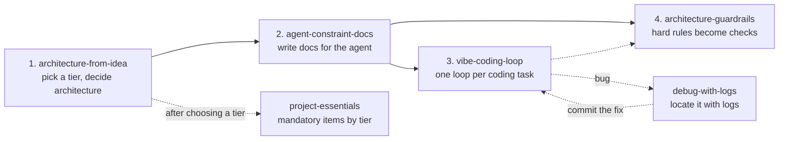

# agent-skills

**English** | [简体中文](README.zh-CN.md)

Agent Skills for building software with AI coding agents — from "I only have an idea" to "the agent codes under written rules, and checks block what must not slip through".

Each skill is a folder with a `SKILL.md` file in the [Agent Skills](https://agentskills.io) format, so it works with agents that read that format, such as [Cursor](https://cursor.com/docs/skills), [Claude Code](https://code.claude.com/docs/en/skills), and [Codex](https://learn.chatgpt.com/docs/build-skills).

> **Language note:** each skill's `description` (the part agents use to pick a skill) is in English. The skill bodies, helper files, and templates are currently written in Simplified Chinese.

## Who this is for

Beginners and "vibe coders" who build with an AI agent but have not yet built up software-engineering habits: designing an architecture before coding, keeping logs that can locate a bug, keeping secrets out of the repo, testing, and being able to roll back.

Think of it as a co-pilot's checklist: the agent still flies the plane, but at fixed moments it must tick every item, and if a required item fails it may not say "done".

## Skills

| Skill | Use it when | What you get |
| --- | --- | --- |
| [`architecture-from-idea`](skills/architecture-from-idea/) | You have an idea or a new project and no architecture yet | A path choice (prototype / tracer bullet / long-lived), architecture decisions, and ADRs — before any feature code |
| [`agent-constraint-docs`](skills/agent-constraint-docs/) | Architecture is agreed; next you write the docs the agent will follow | `AGENTS.md` / `CLAUDE.md`, PRD, ARCHITECTURE, RULES, plus plan, ADR, PR, and task templates |
| [`vibe-coding-loop`](skills/vibe-coding-loop/) | Docs exist; you are implementing one coding task | A scoped task brief, a plan when needed, the change, real command evidence, a review, and a gate table |
| [`architecture-guardrails`](skills/architecture-guardrails/) | A rule must hold with no exceptions | A linter, structural test, CI gate, or agent hook with fix-it messages; copy-in gate templates for your project |
| [`debug-with-logs`](skills/debug-with-logs/) | Something is broken and you don't know why yet | Repro steps, a root cause read from the logs by `request_id`, a minimal fix with a regression test, and a bug report you can hand to the AI |
| [`project-essentials`](skills/project-essentials/) | You start, take over, share, or release a project | The mandatory checklist shared by all skills ([`MANDATORY.md`](skills/project-essentials/MANDATORY.md)) and the software basics by tier |

Helper files travel with each skill, so install the **whole folder**, not just `SKILL.md`:

- `architecture-from-idea`: `DEMO.md` (prototype path), `LONG.md` (long-lived path), `PRINCIPLES.md` (plain-language explanations of terms)
- `agent-constraint-docs`: blank templates in `templates/`
- `vibe-coding-loop`: `SKILL.md` only
- `architecture-guardrails`: check recipes in `recipes/` (including [`logging.md`](skills/architecture-guardrails/recipes/logging.md) and [`mandatory-gates.md`](skills/architecture-guardrails/recipes/mandatory-gates.md)); copy-in gate files in [`templates/project/`](skills/architecture-guardrails/templates/project/)
- `debug-with-logs`: `WORKFLOW.md` (12-step flow), `LOGS.md` (good vs bad logs, minimum fields, where logs live on each platform), `BUG_REPORT.md` (bug report template)
- `project-essentials`: `MANDATORY.md`; one short file per essential in `essentials/`; `.env.example`, `CHANGELOG.md`, `GATE_REPORT.md` (gate table), and `WAIVERS.md` (waiver log) in `templates/`

### How they fit together



You don't need all of them. Start wherever you are: no architecture yet → `architecture-from-idea`; architecture agreed → `agent-constraint-docs`; docs in place → `vibe-coding-loop` (once per task, not one chat for a whole app); a no-exceptions rule → `architecture-guardrails`; a bug at any stage → `debug-with-logs`; starting or releasing → `project-essentials`.

## Tiers and mandatory gates

Everyday version: a pre-flight checklist. Not "I think it's all fine", but a fixed list ticked at fixed moments; one required item fails, the plane does not take off.

Formal version: [`MANDATORY.md`](skills/project-essentials/MANDATORY.md) is the single source of mandatory items M-01 to M-15. Each item is **MUST** (stop if not met), **SHOULD** (report, but continue), or **—** (not applicable), depending on the project tier.

**Three tiers**, chosen in `architecture-from-idea`:

| Tier | What it is | MUST items |
| --- | --- | --- |
| Prototype (demo) | Answers one question, then is thrown away | 7: version control (M-01), one command to run + README (M-02), no secrets in the repo (M-03), minimal logging (M-04), no swallowed errors (M-05), the AI explains each change in plain words before commit (M-07), committed lockfile (M-09) |
| Tracer bullet | The thinnest real end-to-end path, kept as the skeleton | 10: M-01 to M-09 in stronger form (structured logs with `request_id`, smoke + regression tests, independent AI review, CI) plus M-12 decisions and architecture notes |
| Long-lived | Will evolve, ship, and be changed by several people or agents | 11: everything in tracer bullet (stronger again) plus M-13 version number, CHANGELOG, and rollback steps |

- **Conditional items:** if the project stores real user data, M-11 data safety applies to every tier; if other people can reach it, M-10 (8 beginner security basics) applies to every tier, and long-lived projects add M-14 health checks and error reporting (OWASP ASVS L1 self-check recommended).
- **Prototype tests:** a smoke test is recommended, not required; but if tests exist and fail, the prototype is blocked too.
- **Unknown tier:** ask first; if nobody can answer, run as tracer bullet and say so in the gate table.
- **Four gates:** G0 before starting, G1 before calling a task done, G2 before merge, G3 before release. Every row in the gate table is PASS (with evidence: command and exit code, commit, file path, or log line), FAIL, WAIVED, or N/A. Any MUST that is FAIL means "not met" — no "done", no merge, no release.
- **Waivers:** only the user's own words count; they are recorded in the project's `docs/WAIVERS.md` (long-lived projects also write an ADR). The agent cannot waive anything itself.
- **Three red lines, never waivable:** no secrets in the repo; no irreversible operation on real user data without a backup; no invented test or check results.

Every skill starts with the same short gate block, and the `AGENTS.md` template carries a "mandatory items" section so any agent reads it each session.

### Logging from day one

Without logs, a bug found in testing leaves you guessing. So logging is designed in at the architecture step (structured logs, levels, one `request_id` across all layers, never log secrets or personal data), written into the ARCHITECTURE and RULES templates, added by `vibe-coding-loop` when code crosses a boundary, and used by `debug-with-logs` to locate bugs. [`LOGS.md`](skills/debug-with-logs/LOGS.md) lists the minimum fields and where logs live on web, server, browser extension, desktop, CLI, iOS, Android, React Native, and Flutter.

## Machine-layer gates and their limits

Written rules only ask the agent to stop and report; an AI can still ignore them. What actually blocks is a required CI check, a hook, or branch protection. [`architecture-guardrails/templates/project/`](skills/architecture-guardrails/templates/project/) holds files you copy into your own project:

| File | What it does |
| --- | --- |
| `scripts/check` (+ `scripts/check.ps1` for PowerShell) | One command that runs every machine-checkable MUST for your tier and exits non-zero on failure: secrets (including git history, via gitleaks), env files tracked, missing lockfiles, empty `catch` / `except: pass`, README run command, failing tests, missing CI |
| `scripts/check.conf` | Your tier, whether you store real data / are public, and your run / test / install commands |
| `.pre-commit-config.yaml` | Secret scan and fast checks before each commit |
| `.github/workflows/ci.yml` | Runs `scripts/check --ci` on every PR and push to `main` |
| `scripts/agent-stop-hook`, `.claude/settings.json`, `.cursor/hooks.json`, `.codex/hooks.json` | Run the check when the agent tries to finish |
| `.cursor/rules/mandatory.mdc` | A Cursor Always Apply rule pointing at the mandatory section of `AGENTS.md` |

Setup, the full check list, branch protection steps, and a deliberate-violation test are in [`recipes/mandatory-gates.md`](skills/architecture-guardrails/recipes/mandatory-gates.md). If your project already has some of these files, merge them instead of overwriting.

Honest limits:

- **Hooks differ by agent** (checked against each vendor's hooks docs): Claude Code and Codex stop hooks can make the agent keep working when the check fails. Cursor's stop hook **cannot block** the agent from finishing; it can only send an automatic follow-up message (up to 5 times by default).
- `git commit --no-verify` skips pre-commit, and a red CI run only blocks merging once branch protection requires it (and admins are not allowed to bypass).
- The checks are heuristics: they can miss things and can report false positives. Only parts of M-01–M-06, M-08, and M-09 can be machine-checked; the rest relies on the gate table and review.
- Not yet verified in a real environment — tracked in [issue #8](https://github.com/wisdom-km/agent-skills/issues/8): hooks firing inside live agent sessions, `check.ps1` on Windows PowerShell 5.1, the CI workflow on real GitHub Actions, and branch protection blocking a merge in a live repo. So far the templates have only been tested with scripts on Linux.

## Install

Clone the repository, then copy **whole skill folders** to a directory your agent scans:

```bash
git clone https://github.com/wisdom-km/agent-skills.git
cp -R agent-skills/skills/* <your-skills-directory>/
```

Or copy only the skills you want, for example `cp -R agent-skills/skills/debug-with-logs <your-skills-directory>/`.

### Cursor

From the [Cursor Agent Skills docs](https://cursor.com/docs/skills):

| Location | Scope |
| --- | --- |
| `.cursor/skills/` or `.agents/skills/` in your project | That project |
| `~/.cursor/skills/` or `~/.agents/skills/` | All projects on your machine |

Cursor also loads `.claude/skills/` and `.codex/skills/` (and the matching home-directory folders) for compatibility. Type `/` in Agent chat and search for a skill name to invoke it manually. Cursor does not import skills from a GitHub URL on its own (its "From GitHub Repository" import needs a `.cursor-plugin/marketplace.json`, which this repo does not have), so copy the folders. Skills in `~/.cursor/skills/` reach Cloud Agents only after you sync them; see the docs.

### Claude Code

From the [Claude Code skills docs](https://code.claude.com/docs/en/skills):

| Location | Scope |
| --- | --- |
| `.claude/skills/<skill-name>/SKILL.md` in your project | Sessions in that repository; commit it to share with your team |
| `~/.claude/skills/<skill-name>/SKILL.md` | All your projects on this machine |

Claude picks a skill from its `description`, or you can run it directly, for example `/architecture-from-idea`.

### Codex

From the [Build skills docs](https://learn.chatgpt.com/docs/build-skills):

| Location | Scope |
| --- | --- |
| `.agents/skills/` in your repo (scanned from the working directory up to the repository root) | That repository |
| `~/.agents/skills/` | You, in any repository |

You can also ask the built-in `$skill-installer` to download skills from a repository. Mention a skill with `$` or run `/skills`. Codex detects new skills automatically; restart it if one does not appear.

### Other agents

Put each complete skill folder wherever that product's documentation says it reads `SKILL.md` folders. Skills do not move between products by themselves; install them in each environment you use.

## Getting started

Phrase your request close to a skill's description, or name the skill. Agents pick skills by matching the `description`; finishing one step does not automatically open the next, so say what the next step is.

> I have a software idea and the architecture is not decided yet. Follow architecture-from-idea: clarify the product, choose prototype vs tracer bullet vs long-lived, then record the architecture. Do not write feature code yet.

> Architecture is agreed. Follow agent-constraint-docs and generate the agent-facing docs.

> The docs are in place. Follow vibe-coding-loop: write the task brief first, then implement: … (describe the feature)

> Turn this no-exceptions rule into a machine check. Follow architecture-guardrails and make it a linter or CI gate, not just prose.

> Saving fails with error ID r-7f3a9c. Follow debug-with-logs: don't change code yet; find the logs, tell me which layer broke, and give a root-cause hypothesis with the log lines that support it.

> This is a new project; it will store user data and other people will use it. Follow project-essentials: list what I must do now, minimum version of each first.

> Is this task done? Follow vibe-coding-loop and output the G1 gate table. If any MUST fails, don't call it done; tell me how to fix it.

Chinese trigger phrases in the descriptions also work, for example「还没定架构」「下一步写文档」「开始编码」「出错了」「上线前检查」.

## Good to know

- These skills borrow ideas from public engineering guidance (Microsoft Engineering Fundamentals, Software Engineering at Google, the Google SRE launch checklist, OpenAI's harness engineering post, Claude Code best practices, DORA, NIST SSDF, OWASP ASVS); sources are listed in `MANDATORY.md` §10. They are not an official standard of any of those organizations.
- Keep prototype and long-lived methods apart: an architecture built for change is a poor fit for a throwaway prototype, and the reverse.
- Don't paste a skill's body into your application repo; put the generated project docs (`AGENTS.md`, PRD, ARCHITECTURE, …) there instead.

## Repository layout

```
skills/
  <skill-name>/
    SKILL.md      # required: YAML frontmatter (name, description) + instructions for the agent
    README.md     # short human-readable summary
    ...           # helper files, templates, recipes, scripts
LICENSE
README.md
README.zh-CN.md
```

## Contributing

Issues and pull requests are welcome — bug reports, unclear steps, broken links, or a check that misfires.

- One folder per skill under `skills/`; the folder name matches `name` in `SKILL.md`.
- The `description` should say clearly *when* to use the skill — agents rely on it to choose.
- Reference helper files with relative paths from `SKILL.md`.
- Don't state anything as verified unless you checked it; mark the rest as unverified.
- Never commit secrets or real personal data, including in examples.

## License

[MIT](LICENSE) © 2026 wisdom-km
