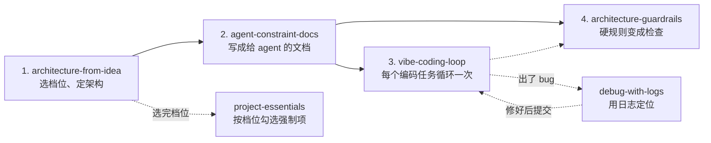

# agent-skills

[English](README.md) | **简体中文**

一套给 AI 编程 agent 用的 Skill：从「只有一个想法」，走到「agent 按写好的规则写代码，不该漏的由检查拦住」。

每个 Skill 是一个文件夹，里面有一份 [Agent Skills](https://agentskills.io) 格式的 `SKILL.md`。支持这个格式的 agent 都能用，例如 [Cursor](https://cursor.com/docs/skills)、[Claude Code](https://code.claude.com/docs/en/skills)、[Codex](https://learn.chatgpt.com/docs/build-skills)。

> **语言说明：** 每个 Skill 的 `description`（agent 靠它决定选不选用）是英文。Skill 正文、配套文件和模板目前是简体中文。

## 给谁用

用 AI agent 写程序、但还没有软件工程习惯的新手和 vibe coder：写代码前先定架构、留下能定位 bug 的日志、密钥不进仓库、写测试、改坏了能回滚。

打个比方：这像副驾驶手里的检查单。飞机还是 agent 在开，但到固定时刻必须逐项打勾；有一项必做的没过，就不能说「完成」。

## Skill 列表

| Skill | 什么时候用 | 产出 |
| --- | --- | --- |
| [`architecture-from-idea`](skills/architecture-from-idea/) | 有想法或新项目，架构还没定 | 选档位（原型 / 曳光弹 / 长期）、架构决定和 ADR；写业务代码之前完成 |
| [`agent-constraint-docs`](skills/agent-constraint-docs/) | 架构定了，下一步写给 agent 遵守的文档 | `AGENTS.md` / `CLAUDE.md`、PRD、ARCHITECTURE、RULES，以及计划、ADR、PR、任务模板 |
| [`vibe-coding-loop`](skills/vibe-coding-loop/) | 文档已经有了，要做一个编码任务 | 有边界的任务单、必要时的计划、改动、真实命令证据、审查和门禁表 |
| [`architecture-guardrails`](skills/architecture-guardrails/) | 某条规则不能有例外 | lint、结构测试、CI 门禁或 agent hook，失败时给出改法；可复制进项目的门禁模板 |
| [`debug-with-logs`](skills/debug-with-logs/) | 出了问题，还不知道原因 | 复现步骤、按 `request_id` 读日志得出的根因、最小修复和回归测试，以及一份可以直接交给 AI 的 bug 报告 |
| [`project-essentials`](skills/project-essentials/) | 开新项目、接手项目、给别人用或发布 | 所有 Skill 共用的强制项清单（[`MANDATORY.md`](skills/project-essentials/MANDATORY.md)），以及按档位列出的软件必备件 |

每个 Skill 都有配套文件，所以要安装**整个文件夹**，不要只拷 `SKILL.md`：

- `architecture-from-idea`：`DEMO.md`（原型路径）、`LONG.md`（长期路径）、`PRINCIPLES.md`（术语的大白话解释）
- `agent-constraint-docs`：`templates/` 下的空白模板
- `vibe-coding-loop`：只有 `SKILL.md`
- `architecture-guardrails`：`recipes/` 下的检查配方（含 [`logging.md`](skills/architecture-guardrails/recipes/logging.md) 和 [`mandatory-gates.md`](skills/architecture-guardrails/recipes/mandatory-gates.md)）；[`templates/project/`](skills/architecture-guardrails/templates/project/) 下是复制进项目的门禁文件
- `debug-with-logs`：`WORKFLOW.md`（12 步定位流程）、`LOGS.md`（好坏日志对比、最少字段、各平台日志在哪看）、`BUG_REPORT.md`（bug 报告模板）
- `project-essentials`：`MANDATORY.md`；`essentials/` 下每个必备件一个短文件；`templates/` 下有 `.env.example`、`CHANGELOG.md`、`GATE_REPORT.md`（门禁表）、`WAIVERS.md`（豁免记录）

### 它们怎么配合



不必全用，从你现在所处的那一步开始：还没定架构，用 `architecture-from-idea`；架构定了，用 `agent-constraint-docs`；文档有了，用 `vibe-coding-loop`（每个任务用一次，不要一个对话做完整个应用）；有不能例外的规则，用 `architecture-guardrails`；任何阶段出了 bug，用 `debug-with-logs`；开工或发布，用 `project-essentials`。

## 档位和强制门禁

日常类比：飞机起飞前的检查单。不是凭感觉「应该都弄好了」，而是在固定时刻按固定清单打勾；有一项必做的没过，就不起飞。

正式定义：[`MANDATORY.md`](skills/project-essentials/MANDATORY.md) 是强制项 M-01 到 M-15 的唯一真相源。每项按项目档位标 **MUST**（不满足就停）、**SHOULD**（要报告，但可以继续）或 **—**（不适用）。

**三个档位**，在 `architecture-from-idea` 里选定：

| 档位 | 是什么 | MUST 项 |
| --- | --- | --- |
| 原型（Demo） | 只为回答一个问题，答完就扔 | 7 项：版本控制（M-01）、一条命令跑 + README（M-02）、密钥不进仓库（M-03）、最小日志（M-04）、不吞错（M-05）、提交前 AI 用人话讲改动（M-07）、锁文件已提交（M-09） |
| 曳光弹 | 端到端最薄的一条真实路径，留下当骨架 | 10 项：M-01 到 M-09 的加强版（结构化日志 + `request_id`、冒烟 + 回归测试、独立 AI 审查、CI），加 M-12 决定和架构笔记 |
| 长期 | 要演进、要上线、多人或多个 agent 会改 | 11 项：曳光弹的全部（再加强），加 M-13 版本号、CHANGELOG 和回滚办法 |

- **条件项：** 存了真实用户数据，三档都加 M-11 数据安全；别人能访问，三档都加 M-10 新手版安全 8 条，长期再加 M-14 健康检查与错误上报（建议做 OWASP ASVS L1 自查）。
- **原型的测试：** 冒烟测试是建议，不强制；但已经有测试却失败时，原型也会被挡住。
- **档位不明：** 先问；问不了，按曳光弹执行，并在门禁表里写明。
- **4 个关口：** G0 开工前、G1 说任务完成前、G2 合入前、G3 发布前。门禁表每一行只能是 PASS（附证据：命令和退出码、提交号、文件路径或日志行）、FAIL、WAIVED、N/A。任一 MUST 是 FAIL，就是「未满足」：不能说完成，不能合入，不能发布。
- **豁免：** 只认用户的原话，记进项目的 `docs/WAIVERS.md`（长期项目另写一条 ADR）。agent 不能自己豁免。
- **3 条红线，任何情况都不能豁免：** 密钥不进仓库；不对真实用户数据做没有备份的不可逆操作；不编造测试或检查结果。

每个 Skill 开头都有同一段简短的门禁规则；`AGENTS.md` 模板有「强制项」一节，任何 agent 每次会话都会读到。

### 从第一天就有日志

没有日志，测试时出了错只能猜。所以日志在定架构时就设计进去（结构化、分级别、一个 `request_id` 贯穿各层、绝不记密钥和个人数据），写进 ARCHITECTURE 和 RULES 模板；`vibe-coding-loop` 在代码跨边界时加日志；`debug-with-logs` 用日志定位 bug。[`LOGS.md`](skills/debug-with-logs/LOGS.md) 列出最少字段，以及网页、服务端、浏览器扩展、桌面、命令行、iOS、Android、React Native、Flutter 的日志位置。

## 机器层门禁和它的限度

写在文档里的规则，只能让 agent 自己停下并报告，AI 仍可能不照做。真正拦得住的是 CI 必需检查、hook 和分支保护。[`architecture-guardrails/templates/project/`](skills/architecture-guardrails/templates/project/) 里是复制进你自己项目的文件：

| 文件 | 作用 |
| --- | --- |
| `scripts/check`（另有 PowerShell 版 `scripts/check.ps1`） | 一条命令按档位跑所有能机器查的 MUST 项，失败时退出码非 0：密钥（用 gitleaks 连历史提交一起扫）、`.env` 被跟踪、缺锁文件、空 `catch` / `except: pass`、README 缺运行命令、测试失败、没配 CI |
| `scripts/check.conf` | 填档位、是否存真实数据 / 是否对外，以及启动、测试、安装命令 |
| `.pre-commit-config.yaml` | 每次提交前做密钥扫描和快速检查 |
| `.github/workflows/ci.yml` | 每个 PR 和推到 `main` 时跑 `scripts/check --ci` |
| `scripts/agent-stop-hook`、`.claude/settings.json`、`.cursor/hooks.json`、`.codex/hooks.json` | agent 想收工时跑检查 |
| `.cursor/rules/mandatory.mdc` | Cursor 的 Always Apply 规则，指向 `AGENTS.md` 的强制项 |

装法、完整检查项、分支保护步骤和故意违规验证，见 [`recipes/mandatory-gates.md`](skills/architecture-guardrails/recipes/mandatory-gates.md)。项目里已经有同名文件时，请合并，不要直接覆盖。

诚实的限度：

- **各 agent 的 hook 不一样**（已对照各家 hooks 官方文档）：Claude Code 和 Codex 的 stop hook 能在检查没过时让 agent 接着改。Cursor 的 stop hook **拦不住** agent 结束，只能自动追发一条后续消息（默认最多 5 次）。
- `git commit --no-verify` 能跳过 pre-commit；红色的 CI 只有在分支保护把它设为必需检查（并且不允许管理员绕过）之后，才能挡住合入。
- 这些检查是启发式的，会漏，也会误报。只有 M-01 到 M-06、M-08、M-09 的一部分能机器查；其余靠门禁表和审查。
- 还没在真实环境核实，记在 [issue #8](https://github.com/wisdom-km/agent-skills/issues/8)：hook 在真实 agent 会话里是否触发；`check.ps1` 在 Windows PowerShell 5.1 上能否运行；CI 在真实的 GitHub Actions 上能否跑通；分支保护在真实仓库里能否挡住合入。目前模板只在 Linux 上用脚本测过。

## 安装

克隆本仓库，把**整个 Skill 文件夹**拷到 agent 会扫描的目录：

```bash
git clone https://github.com/wisdom-km/agent-skills.git
cp -R agent-skills/skills/* <你的 skills 目录>/
```

也可以只拷需要的，例如 `cp -R agent-skills/skills/debug-with-logs <你的 skills 目录>/`。

### Cursor

见 [Cursor Agent Skills 文档](https://cursor.com/docs/skills)：

| 位置 | 范围 |
| --- | --- |
| 项目里的 `.cursor/skills/` 或 `.agents/skills/` | 这个项目 |
| `~/.cursor/skills/` 或 `~/.agents/skills/` | 本机所有项目 |

为了兼容，Cursor 也会读取 `.claude/skills/`、`.codex/skills/` 及对应的用户目录。在 Agent 对话里输入 `/` 再搜 Skill 名字，可以手动调用。Cursor 不会只凭 GitHub 地址自动导入 Skill（它的「From GitHub Repository」导入需要仓库里有 `.cursor-plugin/marketplace.json`，本仓库没有），所以请用拷贝的方式。`~/.cursor/skills/` 里的 Skill 要先同步，Cloud Agent 才能用，详见文档。

### Claude Code

见 [Claude Code Skills 文档](https://code.claude.com/docs/en/skills)：

| 位置 | 范围 |
| --- | --- |
| 项目里的 `.claude/skills/<skill-name>/SKILL.md` | 这个仓库的会话；提交进仓库，团队也能用 |
| `~/.claude/skills/<skill-name>/SKILL.md` | 本机所有项目 |

Claude 会按 `description` 自动选用，也可以直接输入 `/architecture-from-idea` 这类命令调用。

### Codex

见 [Build skills 文档](https://learn.chatgpt.com/docs/build-skills)：

| 位置 | 范围 |
| --- | --- |
| 仓库里的 `.agents/skills/`（从当前目录一直扫到仓库根目录） | 这个仓库 |
| `~/.agents/skills/` | 你自己，任何仓库都能用 |

也可以让内置的 `$skill-installer` 从仓库下载 Skill。用 `$` 点名 Skill，或输入 `/skills`。Codex 会自动发现新 Skill；没出现时，重启 Codex。

### 其他 agent

把每个 Skill 的完整文件夹放到该产品文档规定的 `SKILL.md` 扫描目录即可。Skill 不会在产品之间自动搬家，每个用到的环境都要单独安装。

## 怎么开始用

用接近 Skill 触发说明的话提需求，或直接点名 Skill。agent 是按 `description` 匹配来选 Skill 的；做完一步不会自动跳到下一步，所以请说明下一步要做什么。

> 我有一个软件想法，架构还没定。请按 architecture-from-idea：先问清楚产品，选原型 / 曳光弹 / 长期，再定架构，先不要写业务代码。

> 架构已经定了，下一步写文档。请按 agent-constraint-docs 生成给 AI 的约束文档。

> 文档已经有了，下一步写代码。请按 vibe-coding-loop，先写任务单再实现：……（在这里说明要做的功能）

> 把这条不能有例外的规则变成机器检查。请按 architecture-guardrails 做成 lint 或 CI，不要只写在文档里。

> 点「保存」后报错了，错误编号是 r-7f3a9c。请按 debug-with-logs：先别改代码，帮我找到日志、读出断在哪一层，给出根因假设和证据行。

> 这是一个新项目，会存用户数据，会给别人用。请按 project-essentials 列出现在必须做的事，每项先做最低版。

> 这个任务做完了吗？请按 vibe-coding-loop 输出 G1 门禁表；任一 MUST 是 FAIL 就别说完成，先告诉我怎么补。

也可以不提英文名，直接说「还没定架构」「下一步写文档」「开始编码」「出错了」「上线前检查」，这些短语已经写在触发说明里。

## 使用须知

- 这些 Skill 借鉴了公开的工程实践（Microsoft Engineering Fundamentals、Software Engineering at Google、Google SRE 发布检查清单、OpenAI 的 harness engineering 文章、Claude Code best practices、DORA、NIST SSDF、OWASP ASVS），来源列在 `MANDATORY.md` 第 10 节。它们不是这些机构的官方标准。
- 原型和长期项目的方法不要混用：为高可改性设计的架构不适合一次性原型，反过来也一样。
- 不要把 Skill 正文贴进你的业务仓库；项目里只放生成出来的文档（`AGENTS.md`、PRD、ARCHITECTURE 等）。

## 仓库结构

```
skills/
  <skill-name>/
    SKILL.md      # 必需：YAML frontmatter（name、description）+ 给 agent 的步骤
    README.md     # 给人看的简短说明
    ...           # 配套文件、模板、配方、脚本
LICENSE
README.md
README.zh-CN.md
```

## 参与贡献

欢迎提 Issue 和 PR：报 bug、指出说不清的步骤、坏掉的链接，或误报的检查。

- `skills/` 下每个 Skill 一个文件夹，文件夹名和 `SKILL.md` 里的 `name` 一致。
- `description` 要写清**什么时候用**，agent 靠它决定选不选用。
- `SKILL.md` 用相对路径引用配套文件。
- 没核实的内容不要写成已核实，要标明「未核实」。
- 不要提交密钥或真实个人数据，示例里也不要。

## 许可证

[MIT](LICENSE) © 2026 wisdom-km
